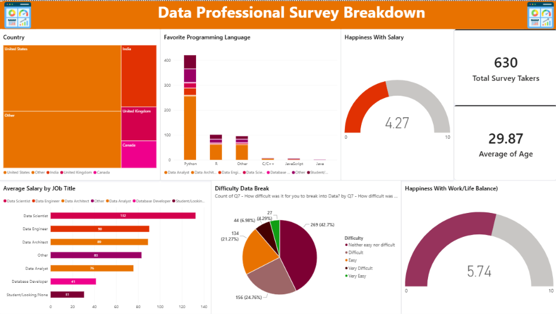

# 📊 Data Professional Survey Analysis | Power BI

## 📌 Project Overview

An interactive Power BI dashboard analyzing survey responses from **630 data professionals**.

This project explores salary trends, programming language preferences, job roles, career-entry difficulty, and work-life satisfaction across the data industry.

## 🛠️ Tools & Technologies

- Microsoft Power BI
- Data Cleaning
- Data Transformation
- Data Visualization

## 📷 Dashboard Preview

## 📈 Key Performance Indicators (KPIs)

| Metric | Result |
|---|---:|
| Total Survey Takers | 630 |
| Average Age | 29.87 |
| Happiness With Salary | 4.27 / 10 |
| Happiness With Work-Life Balance | 5.74 / 10 |

## 🔍 Key Analysis

**1. Country Distribution**
- Analyzed survey participants across different countries.
- Compared participation by country.

**2. Programming Language Preferences**
- Python is the most popular programming language.
- Compared language preferences across job roles.

**3. Average Salary by Job Title**
- Compared average salaries across different data professions.
- Data Scientists have the highest displayed average salary.

**4. Difficulty Entering the Data Industry**
- Analyzed how respondents perceive entering the data industry.
- 42.7% consider it neither easy nor difficult.

**5. Job Satisfaction**
- Analyzed satisfaction with salary and work-life balance.
- Work-life balance satisfaction is higher than salary satisfaction.

## 💡 Key Insights

- Python leads programming language preferences.
- Data Scientists have the highest average salary in the dashboard.
- Average work-life balance satisfaction is 5.74/10.
- Average salary satisfaction is 4.27/10.

## 📂 Project Files

- `Power-BI-Project.pbix` — Complete interactive Power BI dashboard.
- `screenshots/dashboard.png` — Dashboard preview.

## 👨‍💻 Author

**Khemraj**

Aspiring Data Analyst

Skills: Excel | SQL | Power BI | Python

GitHub: [khemraj-analyst](https://github.com/khemraj-analyst)
